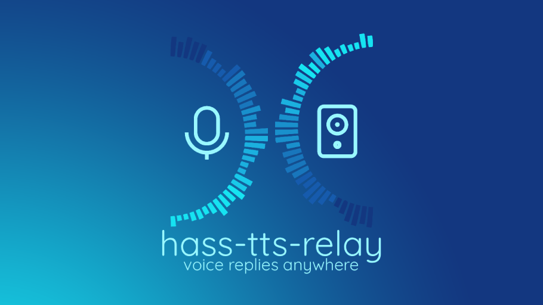

<div align="center">
  
  <h1>hass-tts-relay</h1>
</div>

<p align="center">
	Allows you to relay voice satellite TTS responses and announcements to any <code>media_player</code> entity,<br>and to change the response contents via custom rules.
</p>

<p align="center">
	<a href="https://github.com/charludo/hass-tts-relay/stargazers">
		</a>
	<a href="https://github.com/charludo/hass-tts-relay/issues">
		</a>
	<a href="https://github.com/charludo/hass-tts-relay">
		</a>
</p>

&#160;

### 📜 Problem statement and solution

If you're using Home Assistant, there's a good chance you already own network-enabled speakers that can be addressed via Home Assistant.
You might want to play TTS responses, acknowledgements, or error chimes on that speaker rather than on a cheap, low-volume additional speaker attached to the satellite itself.
Home Assistant doesn't provide functionality for this today.

Quality-of-life features like volume-ducking on speakers to make a voice satellite understand you better over music are also hard to implement currently.

This custom integration allows you to relay the answers Home Assistant gives to voice commands.
You don't need to have a speaker connected to the satellite itself anymore, and can instead relay the output to any Home Assistant `media_player` entity *(with a small asterisk, see below)*.

Additionally, ducking works for a lot of players out of the box (more on this below as well), and you can define custom Jinja-based rules to change the answer played on the speaker.

I've been using this approach for a couple of months now, with no issues at all, on some Sonos speakers.
If you encounter any problems, please feel free to open an issue.

### 📽 Demo

Here's a short demo video (watch it with sound!).

[Demo Video (with sound)](https://github.com/user-attachments/assets/1c121e02-4243-4a38-9dcf-8b9d71e5375d)

Notice:

- Music is playing from the speaker.
- Satellite and speaker are not connected.
- Upon wake word detection and during TTS replies, music volume is ducked.
- A custom rule replaces "Strahler is now on." with a chime.
- No perceptible extra latency (!).

&#160;

### 💡 How it works

The satellite gets the reply's audio URL in the voice pipeline's `tts-end` event, but Home Assistant hands that event *only* to the satellite entity, not to the event bus.
Automations can therefore never see it, which makes rerouting the reply difficult.
The TTS Relay instead wraps the satellite entity's pipeline callback, to expose the event on the bus, where we can then do whatever we want with it.

> [!WARNING]
> That callback is internal to Home Assistant, so a Home Assistant update can break this integration. If replies stop reaching the speaker after an update, check the log and open an issue.

&#160;

### 📦 Installation

[](https://my.home-assistant.io/redirect/hacs_repository/?owner=charludo&repository=hass-tts-relay&category=integration)

Requires Home Assistant 2026.11 or newer.

1. Go to **Settings** -> **Marketplace** and select **Add from link** (top right).
1. Enter `charludo/hass-tts-relay` and select **Add**. If asked, connect Home Assistant to GitHub first.
1. Open **TTS Relay** and install it.
1. Restart Home Assistant.
1. Add the integration (see below).

&#160;

### ⚙️ Configuration

Go to **Settings** -> **Devices & services** -> **Add integration** and add **TTS Relay**.
Add a route.
Each route relays one or more satellites to one speaker.

| Option | Default | Meaning |
| --- | --- | --- |
| `name` | - | Name for the route. Must be unique. |
| `satellites` | - | The `assist_satellite` entities whose replies to relay. Satellites can only be in one route. |
| `target` | - | The media player to play replies on. Players must support announcements. If your player doesn't show up here. In that case, see the workarounds in [Limitations](#%EF%B8%8F-limitations). |
| `volume` | - | (Sonos only) Volume of the replies. This is independent of the main volume of the Sonos. |
| `duck` | `true` | Duck the normal speaker output while you are saying a voice command. See [Ducking](#-ducking). |
| `announcements` | `true` | Also play the satellite's announcements on the speaker. Reply rules don't apply to these. |
| `rules` | `["intent_sounds"]` | Which [reply rules](#-reply-rules) apply. |

#### YAML configuration

> [!WARNING]
> A route configured in YAML can't be edited in the UI.
> YAML routes show up on the integration's page marked "*(YAML)*", but are read-only.
> Editing or deleting them in the UI has no effect.

```yaml
tts_relay:
  sounds: # optional, see Reply rules below
    error: /local/sounds/error.mp3
  routes:
    - name: Living room to Sonos
      satellites:
        - assist_satellite.living_room
        - assist_satellite.dining_room
      target: media_player.living_room
      volume: 0.35 # Sonos only, optional, 0–1
      duck: true # see Ducking below
      announcements: true
      rules: # optional, see Reply rules below
        - intent_sounds
        - quiet_on_no_match
```

#### Silence the satellite

TTS Relay only, well, relays the responses, it doesn't stop Home Assistant from sending the "original" response to the satellite.
Thus if you actually *do* have a speaker plugged into the satellite and configured for output, you will hear responses on both the satellite speaker and the TTS Relay-configured one.

The simplest fix is to just unplug the satellite speaker.
The reason we don't stop sending the response to the satellite is that LVA & Co use the audio to determine how long LED animations etc. should play, and when to start listening for a wake word again.
If your setup does not *have* an audio-out, try and see if you can configure a dummy card.
E.g. in Linux, this might look like:

```sh
modprobe snd-dummy                 # load the dummy sound card now
snd-dummy | tee -a /etc/modules    # and on every boot
aplay -l | grep Dummy              # check it's there
```

Then point the satellite at it, e.g. for LVA add:

```sh
--audio-output-device alsa/plughw:CARD=Dummy
```

&#160;

### 🎶 Reply rules

Reply rules are a "bonus feature" of TTS Relay.
You don't have to use them.
But since this integration needs to wrap the satellite entity's pipeline callback anyway, we might as well take the opportunity to improve the responses 🙂

These reply rules allow you to suppress or change responses based on per-intent configuration, or on Home Assistant state!

As shown in the config section above, rules are configurable per route.

#### Shipped rules

| ID | Name | Default | What it does |
| --- | --- | --- | --- |
| `intent_sounds` | Sounds requested by intents | `true` | Allows an intent to ask for a specific sound instead of its TTS output (see below), or for `silent`. |
| `quiet_on_no_match` | Quiet on misses | `false` | If no intent matched what STT understood, just say nothing instead of apologising (this makes false wakes **much** less annoying!). |
| `chime_on_success` | Chime on success | `false` | If a built-in command ran successfully, play the sound `acknowledge` instead of confirming it in words. |
| `chime_on_error` | Chime on errors | `false` | If a built-in command ran into an error, play the sound `error` instead of the explanation/apology. |

To configure per-intent sounds, [cards](https://www.home-assistant.io/integrations/intent_script/#card) are used.
Cards are usually used to show something on a satellite's display, but luckily, they have a "type" field, and unknown types are simply ignored.
Therefore, you can add the `tts_relay` type cards to your custom intents without side effects.

The title of the card determines a sound to play, for example a chime instead of the TTS reply, or "silent".
I use "silent" on a lot of my intents, esp. ones that play media.
Music or a podcast starting is response enough IMO, I don't need an "OK, playing xyz." announcement for this.

```yaml
intent_script:
  PlayMusic:
    action: [...]
    speech:
      text: "OK, playing music"
    card:
      type: tts_relay
      title: silent
      content: ""
```

#### Sounds

Drop audio files to be used into `<config>/tts_relay/sounds/`.
The file name without its extension is used as the sound's name (e.g., `error.mp3` becomes `error`).

Alternatively, name sounds already reachable by URL in YAML:

```yaml
tts_relay:
  sounds:
    acknowledge: /local/sounds/ding.mp3
```

Make sure to run the **TTS Relay: Reload** action after adding or changing sounds.

#### Custom rules

A rule is a YAML file in `<config>/tts_relay/rules/`.
Again, the file name is used as its ID.
A file named like a shipped rule replaces the rule.
Make sure to run the **TTS Relay: Reload** action after adding or changing rules.

For example, you could use the following rule to play a different chime (quieter, softer instruments, whatever) during the night than during the day:

```yaml
# <config>/tts_relay/rules/night_chime.yaml
name: Softer chime at night
description: Between sunset and sunrise, a softer chime when a command worked.
priority: 15 # before chime_on_success (20), which plays the normal chime
reply: >-
  {{ 'acknowledge_night' if is_state('sun.sun', 'below_horizon')
     and (acknowledged or response.response_type == 'action_done') }}
```

See [the Home Assistant contributors' docs](https://contributors.home-assistant.io/core/internals/conversation-api/#the-response) for details on the `response` object.
As you can see from the example above, you can use the same Jinja shortcuts as everywhere else in Home Assistant to make decisions on what, if anything, to play.

The `reply` field is a template. It has access to the `response` (i.e. the original intent response object), `speech`, `error_code`, `card` (the `tts_relay` card, or none), `acknowledged` (Home Assistant replaced the speech with its own beep), `sounds`, `satellite`, `target`, `tts_url` and `intent_output`, and renders to:

- nothing: no opinion, the next rule decides;
- `drop`: play nothing;
- `speech`: play the spoken reply;
- a sound's name, a URL, or a path on Home Assistant (`/local/...`): that.

The first rule that is not "nothing" wins.
If no rule matches, the reply is forwarded unchanged, i.e. the TTS output plays normally.

&#160;

### 🔉 Ducking

"Ducking" refers to the volume of whatever is currently playing on a speaker being temporarily reduced.
With a voice satellite, this should happen both after the wake word has been recognized and you are giving a command, so that the STT has a better shot at understanding you;
and while TTS output plays, so that you have a better time understanding the response.

Since TTS Relay requires media players to support the `anounce` feature, ducking while TTS plays is generally well-supported and should work rather flawlessly.
For ducking while a command is being given, it's a bit more complicated.
For most media players, we lower the volume to 30% of current volume once the wake word has been detected, and raise it back up once end of speech has been detected.
This should work just fine, but is admittedly a bit hacky.

For Sonos, there's a slightly nicer solution, where we just "announce" a silent audio clip.
The reason this only works for Sonos is because the other player integrations don't allow us to cancel an announcement mid-way, so you'd be stuck with the ducking for a fixed amount of time.

&#160;

### 🔈 Sonos troubleshooting

Speaking of Sonos speakers, when I was initially writing this, I ran into an issue where the response would play about 7 seconds too late.
The cause was a combination of multiple things:

- For every announcement you send to Sonos, the Sonos tries to phone home to the company's servers for... something. I honestly have no idea what.
- Because I don't want my devices to talk to *any* company servers (I'm sure most of you can relate), I put them in an isolated VLAN.
- In that VLAN, the outgoing rule was set to `block`. Sonos never gets a response in that mode, so it waits for an internal timeout (of, apparently, 7 seconds) to (begrudgingly, I imagine) play your announcement.

If you face the same issue, simply set the rule to `reject`.
The announcements will then play instantly, without waiting for that timeout.

&#160;

### 🔍 Actions

TTS Relay comes with two helper actions.
Both can be called from **Settings** -> **Developer tools** -> **Actions** -> search for `TTS Relay`.
They also work from automations and scripts.

#### `tts_relay.stop`

Stops playback on media players, importantly including announcements still playing.
On Sonos, announcements survive a regular `media_player.media_stop`, so a reply can't be silenced without this.

```yaml
action: tts_relay.stop
data:
  entity_id: media_player.living_room
```

#### `tts_relay.reload`

Reads the reply rules and sounds again.

&#160;

### ⚠️ Limitations

- Only speakers that support announcements (Sonos, Music Assistant, ESPHome, Squeezebox, Bang & Olufsen, OwnTone).
  **For any other (Cast, AirPlay, DLNA, ...),** a workaround is to add that speaker to [Music Assistant](https://music-assistant.io) and pick the `media_player` entity Music Assistant creates for it instead.
  This is because Music Assistant implements announcements for these, and I didn't want to reinvent the wheel here.
- One speaker per satellite.
- Announcements repeated within 5 seconds get dropped (because we need to deduplicate announcements going to multiple satellites that are TTS Relay-routed to a single speaker).
- Pre-announcement chimes are dropped without replacement, due to wildly varying behavior on different speakers how multiple announcements in quick successions are handled.

If you want to tackle any of these, PRs are always welcome 🙂

&#160;

<a href="https://www.buymeacoffee.com/charludo" target="_blank"></a>

&#160;
